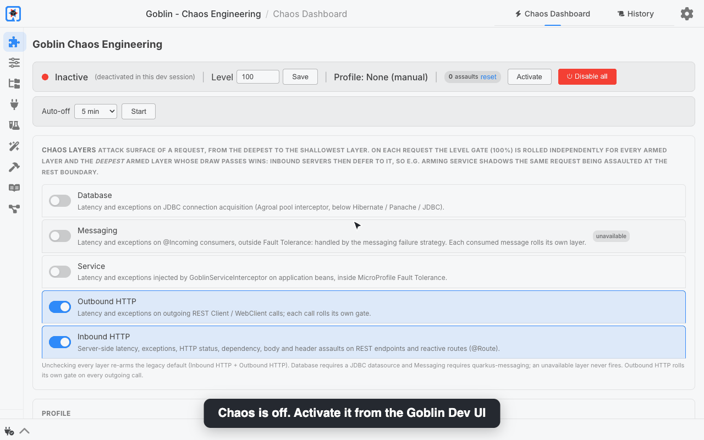

# quarkus-goblin

[](https://openjdk.org/)
[](https://quarkus.io/)
[](https://opensource.org/licenses/Apache-2.0)
[]()
[](https://github.com/quarkiverse/quarkus-goblin/actions/workflows/build.yml)
[](https://github.com/quarkiverse/quarkus-goblin/tree/badges)

Chaos engineering extension for Quarkus -- inject latency, exceptions, HTTP failures, and dependency degradation into your running application without touching a single line of source code.



<sub>Recorded on the [demo application](#demo-application): latency is switched on from the Dev UI, the merchant-guild call behind `@Timeout` + `@Retry` gives up and `@Fallback` answers `MARCHAND_ABSENT`; then the latency is swapped for a `ConnectException` on the outgoing call, which fails fast into the same fallback. Every assault lands in the history.</sub>

## Why?

Quarkus has excellent resilience primitives (MicroProfile Fault Tolerance, Mutiny reactive timeouts, health probes), but no built-in way to **trigger** the failures these mechanisms are supposed to handle. Goblin fills that gap.

## Features

- **Latency injection** -- Artificial delay before processing (configurable min/max ms)
- **Exception injection** -- Throw configurable exceptions before method execution
- **HTTP status forcing** -- Return specific HTTP status codes (503, 500, etc.)
- **Dependency degradation** -- Simulate downstream service failures
- **Response body injection** -- Truncate or inflate the response entity (`TRUNCATE` keeps the first N%, `INFLATE` pads it) to break strict JSON clients and length-validating consumers. On REST resources it applies to `String`, `CharSequence` and `byte[]` entities, and an object serialized by a JSON provider (e.g. a POJO) is left untouched; on reactive routes it applies to any payload written in one go (`end(...)`), POJOs included, and a streamed response is left untouched
- **Response header injection** -- Set or remove headers on emitted responses (`SET` forces the value, replacing an existing header or adding it when absent; `REMOVE` deletes it when present)
- **Reactive routes** -- With `quarkus-reactive-routes`, `@Route` methods get every server-side assault too (latency, exception, HTTP status, dependency degradation, response body and response header), with no code change; on the event loop the latency uses a Vert.x timer, never a blocking sleep
- **Client-side assaults** -- Inject latency and exceptions into outgoing MicroProfile / Quarkus REST Client calls (`quarkus-rest-client`) and Vert.x `WebClient` calls (the clients the application creates are armed automatically in dev and test mode)
- **Metrics** -- Optional `quarkus-goblin-metrics` module exposing assault activity as Micrometer / Prometheus metrics (`goblin_assaults_total`, `goblin_latency_injected_seconds`, `goblin_active`, see the [Metrics guide](docs/modules/ROOT/pages/metrics.adoc))
- **Tracing** -- Optional `quarkus-goblin-opentelemetry` module emitting one `goblin.assault` span per assault with `goblin.assault.*` attributes, linked to the parent request span (see the [Tracing guide](docs/modules/ROOT/pages/tracing.adoc))
- **Multiple types simultaneously** -- Enable latency + exception together for slow failure simulation
- **Targeting** -- By package, by annotation, by percentage of requests
- **Dev UI** -- Toggle assaults, edit config, view history -- all in real time
- **State persistence** -- Dev UI config changes survive restarts automatically (`.goblin-state.json`, dev mode); the master on/off toggle is not written to that file: a deactivation survives the live reloads of the running dev process, and a new process starts from `quarkus.goblin.enabled`
- **Markdown report export** -- Generate a factual report of config + assault history, ready to hand to an LLM for resilience review
- **Multi-layer chaos** -- Arm the `DATABASE`, `MESSAGING`, `SERVICE`, `HTTP_OUT` and `HTTP_IN` layers independently (Dev UI switches): `DATABASE` fails or delays JDBC connection acquisition (Agroal, below Hibernate / Panache), `MESSAGING` faults `@Incoming` consumers, `HTTP_IN` covers JAX-RS endpoints and reactive routes, and `SERVICE` injects latency/exceptions on business beans *inside* MicroProfile Fault Tolerance (`@Priority(4100)`), so `@Retry`, `@Fallback`, `@Timeout` and `@CircuitBreaker` react for real
- **Dev by default, tests on opt-in** -- Chaos activates under `quarkus:dev`, and under `@QuarkusTest` only with `quarkus.goblin.test.enabled=true`; never in production: Goblin is declared `provided`, and a production build that still carries it fails

## Quick start

Add the dependency:

```xml
<dependency>
    <groupId>io.quarkiverse.goblin</groupId>
    <artifactId>quarkus-goblin</artifactId>
    <version>${goblin.version}</version>
    <scope>provided</scope>
</dependency>
```

The `provided` scope is not optional: Goblin must never reach production. It keeps the extension in `quarkus:dev` and `@QuarkusTest` and out of the packaged application, and a production build that still carries Goblin fails. With Gradle, declare it as a `quarkusDev` and a `testImplementation` dependency.

Start in dev mode:

```bash
./mvnw quarkus:dev
```

Open the Dev UI at `http://localhost:8080/q/dev` and look for the Goblin card.

## Demo application

[quarkus-goblin-demo](https://github.com/ErwanLT/quarkus-goblin-demo) -- *The Falling Whale* -- is a complete Quarkus application to try Goblin on: a medieval tavern whose services are guarded by MicroProfile Fault Tolerance (`@Retry`, `@Fallback`, `@Timeout`, `@CircuitBreaker`, `@RateLimit`), with a database, an outgoing REST client, and an observability stack. It also ships an `AGENTS.md` to let an AI agent run the chaos experiments through Dev MCP.

The complete guide, recorded on the demo application under real traffic: every assault, the blast radius, the chaos layers, profiles, scenarios and auto-off, the history and the Markdown report, Prometheus, Grafana, Loki and Tempo, driving Goblin from an AI agent through Dev MCP, and the post-mortem the tavern writes on its own:

<a href="https://youtu.be/m1r9_GVlTNs"></a>

Short on time? The [three-minute tour](https://www.youtube.com/watch?v=owd2kXIM9Z4) goes through the same story at a faster pace.

## They talk about it

- [Quarkus Chaos Engineering: Meet Goblin, a Chaos Monkey for Quarkus](https://medium.com/javarevisited/quarkus-chaos-engineering-meet-goblin-a-chaos-monkey-for-quarkus-58360758f679) -- Erwan Le Tutour, *Javarevisited* (September 2026). The story behind the extension, by its author: why Quarkus needed an application-level Chaos Monkey, and how Goblin injects latency, exceptions, HTTP failures and dependency degradation into a running application.
- [Quarkus Goblin: Learn Chaos Engineering on One REST Call](https://www.the-main-thread.com/p/quarkus-goblin-chaos-engineering) -- Markus Eisele, *The Main Thread* (September 2026). A hands-on tutorial: a quote API calling an inventory service, latency and HTTP 503 injected by Goblin, and SmallRye Fault Tolerance `@Timeout`/`@Retry`/`@Fallback` taking over.

## Configuration

```properties
# Enable/disable (default: true, only ever active in dev mode and, on opt-in, in test mode)
quarkus.goblin.enabled=true

# Opt in to chaos in @QuarkusTest (default: false, so adding the extension never slows down nor breaks your tests)
# quarkus.goblin.test.enabled=true

# Assault type enabled at startup (can be changed at runtime via Dev UI)
quarkus.goblin.assault.type=LATENCY

# Predefined composite assault mode: NONE, SLOW_FAILURE, INTERMITTENT, TIMEOUT
# Overrides assault.type when not NONE. Individual assaults stay user-overridable.
# At startup, a non-NONE profile takes precedence over the static assault toggles/params above.
quarkus.goblin.assault.profile=NONE

# Latency settings
quarkus.goblin.assault.latency.min-milliseconds=100
quarkus.goblin.assault.latency.max-milliseconds=5000

# Exception settings
quarkus.goblin.assault.exception.type=java.lang.RuntimeException
quarkus.goblin.assault.exception.message=Goblin chaos: simulated exception

# HTTP status settings
quarkus.goblin.assault.http-status.code=503
quarkus.goblin.assault.http-status.message=Service Unavailable (Goblin chaos)

# Response body settings
quarkus.goblin.assault.body.mode=truncate
quarkus.goblin.assault.body.percentage=50

# Response header rules (actions: set, remove)
# SET forces the header with the value (replacing an existing one or adding it when absent)
# REMOVE deletes the header when present (value ignored)
quarkus.goblin.assault.headers.X-Chaos.action=set
quarkus.goblin.assault.headers.X-Chaos.value=goblin
quarkus.goblin.assault.headers.Cache-Control.action=set
quarkus.goblin.assault.headers.Cache-Control.value=no-store

# Target level (0-100% of requests affected)
quarkus.goblin.target.level=100

# Optional: include/exclude packages
# quarkus.goblin.target.include-packages=com.example.api
# quarkus.goblin.target.exclude-packages=com.example.health

# Optional: exclude annotated methods
# quarkus.goblin.target.exclude-annotations=org.eclipse.microprofile.faulttolerance.Timeout
```

## Metrics (optional)

Add the `quarkus-goblin-metrics` module to expose the assault activity through Micrometer, so it shows up in your
Prometheus / Grafana dashboards:

```xml
<dependency>
    <groupId>io.quarkiverse.goblin</groupId>
    <artifactId>quarkus-goblin-metrics</artifactId>
    <version>${goblin.version}</version>
    <scope>provided</scope>
</dependency>
```

The module depends on the Micrometer API only: add the registry you use, e.g.
`io.quarkus:quarkus-micrometer-registry-prometheus`, whose `/q/metrics` endpoint then exposes:

- `goblin_assaults_total` -- counter of every fired assault, tagged by `type` and `source` (`server`, `service`, `rest-client`, `webclient`, `database`, `messaging`)
- `goblin_latency_injected_seconds` -- timer of the delays actually injected, tagged by `source`, published as a histogram (`_sum`/`_count`/`_max` plus `_bucket` series; see the [guide](docs/modules/ROOT/pages/metrics.adoc) for bucket tuning)
- `goblin_active` -- gauge, `1` while the engine is active, `0` otherwise

## Tracing (optional)

Add the `quarkus-goblin-opentelemetry` module to surface every assault as an OpenTelemetry span in your existing
tracing backend:

```xml
<dependency>
    <groupId>io.quarkiverse.goblin</groupId>
    <artifactId>quarkus-goblin-opentelemetry</artifactId>
    <version>${goblin.version}</version>
    <scope>provided</scope>
</dependency>
```

Each assault produces one span named `goblin.assault`:

- kind `INTERNAL` (the OpenTelemetry default) for every assault: the span annotates an in-process moment and makes no network call of its own, so `CLIENT`/`SERVER` labels would fabricate phantom dependency edges or duplicate the request topology
- attributes `goblin.assault.type`, `.source` (`server`, `service`, `rest-client`, `webclient`, `database`, `messaging`), `.target.method`, the injected value (`.latency_ms`, `.status_code`, `.exception`) and the `.config` snapshot
- linked to the parent request span; for latency, the injected delay is back-dated so it is attributed to the span; exception assaults mark the span `ERROR` (see the [guide](docs/modules/ROOT/pages/tracing.adoc))

## Dev UI

The Chaos Dashboard provides:

- **Master toggle** -- Activate/deactivate all chaos, with an optional auto-off (5 to 60 minutes) enforced by the engine even when the Dev UI is closed
- **Profile selector** -- Switch a whole server-side assault setup (`NONE`, `SLOW_FAILURE`, `INTERMITTENT`, `TIMEOUT`) in one click: a profile turns every server-side assault off, then enables its own; client-side toggles and layers are untouched and individual toggles stay overridable
- **Assault type toggles** -- Independent on/off for Latency, Exception, HTTP Status, Dependency Degradation, Response Body, and Response Header
- **Client-side assault toggles** -- `client latency` and `client exception` for outgoing REST Client and Vert.x WebClient calls
- **Config sections** -- Edit parameters per type (a summary of the current values when the type is off)
- **Target level** -- Adjust percentage of affected requests
- **History** -- Live chaos-testing console: 2-second auto-refresh, newest-first ordering, filters (assault type, method, time period), a summary band with totals and average injected latency, and expandable Active Config cells
- **Markdown report** -- "Export Markdown" button in the History panel generates a factual report of the current configuration and assault history (copy or download it), handy for pasting into an LLM assistant (e.g. Claude) for a resilience review

All changes apply instantly, each one logged as a structured `config-change` event, and are persisted to `.goblin-state.json` across restarts (except the master toggle: a deactivation survives the live reloads of the running dev process, and a new process starts from `quarkus.goblin.enabled`). Invalid values are never applied: Goblin logs a clear message and applies a safe fallback -- inverted latency ranges are swapped, out-of-range HTTP status codes (100-599) fall back to 503, unknown exception classes fall back to `RuntimeException`, the response body percentage is clamped to its mode's valid range (0-100 for `TRUNCATE`, 101-1000 for `INFLATE`), response header rules with an unknown action or an invalid name are rejected, and the target level is clamped to 0-100. In the dashboard, a warning toast explains the applied correction.

## Safety

- **Dev by default, tests on opt-in** -- Chaos activates in `quarkus:dev`. In `@QuarkusTest` it stays off unless `quarkus.goblin.test.enabled=true`, so adding the extension never slows down nor breaks an existing test suite; a single test can also switch it on with `AssaultEngine.setActive(true)`.
- **Zero code modification** -- No annotations needed for the server-side and REST Client assaults; Vert.x `WebClient` instances are armed automatically, and the application code never refers to Goblin.
- **Explicit logging** -- WARN log emitted when chaos is active.

## Repository layout

Each module carries its own README for contributors:

- [runtime](runtime/README.md) -- the assault abstraction and how to add a new assault (the extension SPI)
- [metrics](metrics/README.md) -- optional Micrometer / Prometheus metrics for assault activity
- [opentelemetry](opentelemetry/README.md) -- optional OpenTelemetry traces for each assault
- [runtime-dev](runtime-dev/README.md) -- the Dev UI JSON-RPC backend (dev mode only)
- [deployment](deployment/README.md) -- build steps, bean registration, and Dev UI wiring
- [integration-tests](integration-tests/README.md) -- the `@QuarkusTest` suite and how to extend it
- [docs](docs/README.md) -- the Antora documentation sources

## Documentation

The full AsciiDoc guide lives in [`docs/modules/ROOT/pages/`](docs/modules/ROOT/pages/) (`index.adoc`), covering assault types, targeting, configuration validation, the Dev UI (with screenshots), an end-to-end example, resilience testing guides (circuit breakers, retries, fallbacks, performance baselines), a JSON-RPC reference, and a FAQ.

Screenshots of the Dev UI are stored in [`docs/modules/ROOT/assets/images/`](docs/modules/ROOT/assets/images/).

## Coverage

Test coverage is aggregated by JaCoCo (`report-aggregate` on `integration-tests`). On every push to `main`, the `coverage` CI job recomputes the instruction coverage and publishes `coverage.json` to the [`badges`](https://github.com/quarkiverse/quarkus-goblin/tree/badges) branch, which feeds the badge above through a [shields.io endpoint](https://shields.io/badges/endpoint-badge).

To inspect the full HTML report locally:

```bash
mvn clean install -Dno-format
open integration-tests/target/site/jacoco-aggregate/index.html
```

The badge color follows the coverage: `brightgreen` >= 90%, `green` >= 80%, `yellowgreen` >= 70%, `yellow` >= 60%, `red` < 60%.

## Requirements

- Java 25+
- Quarkus 3.38+

## License

Apache License 2.0
